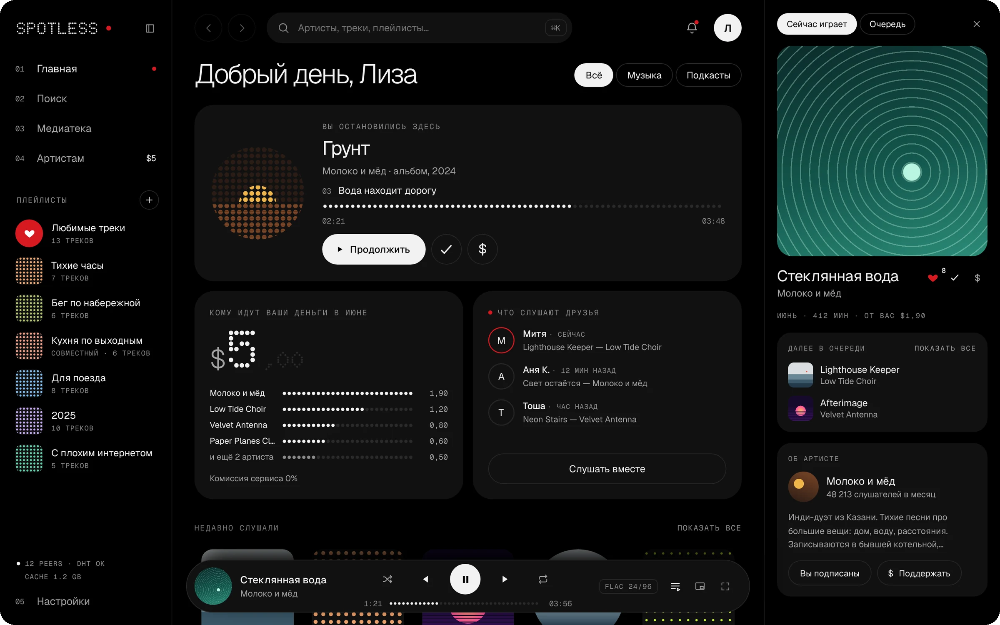
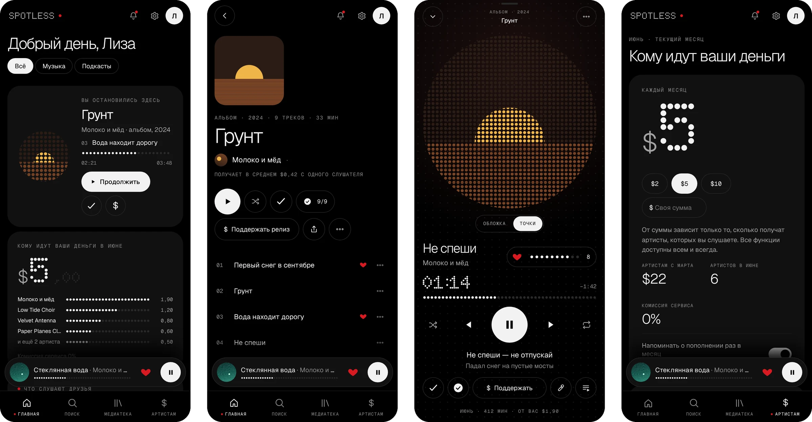
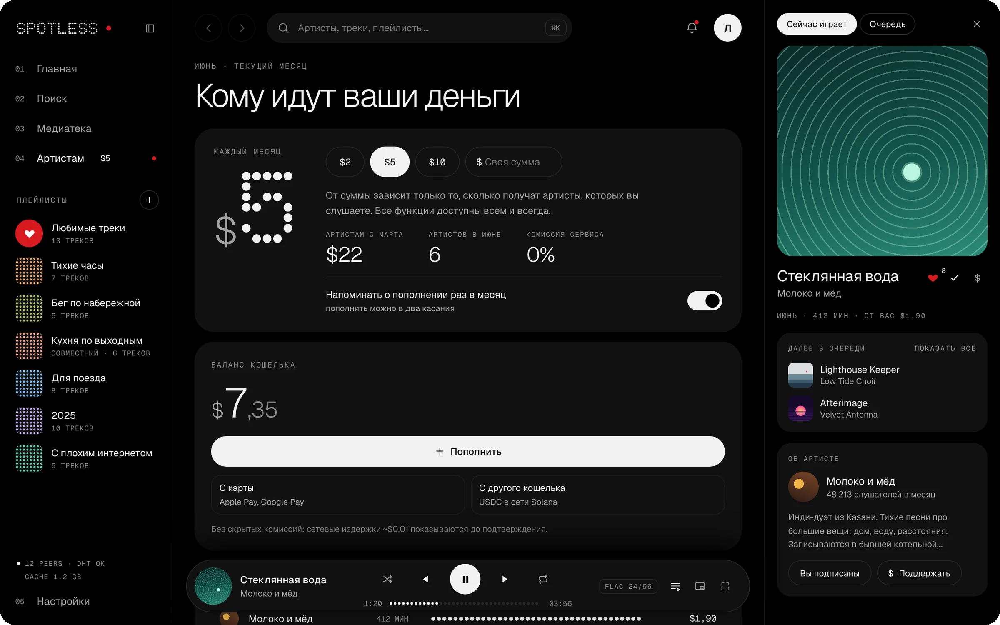
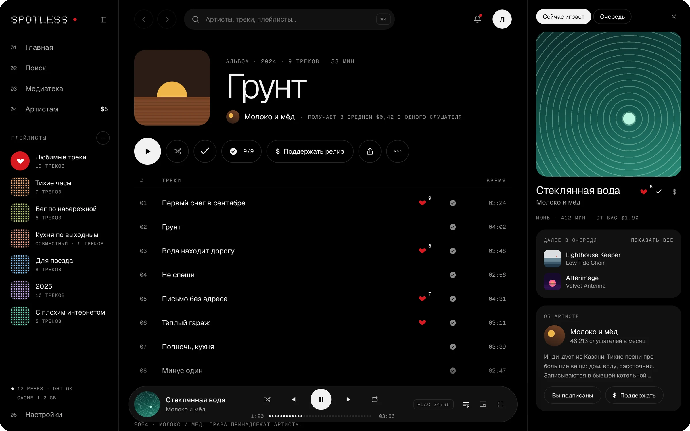
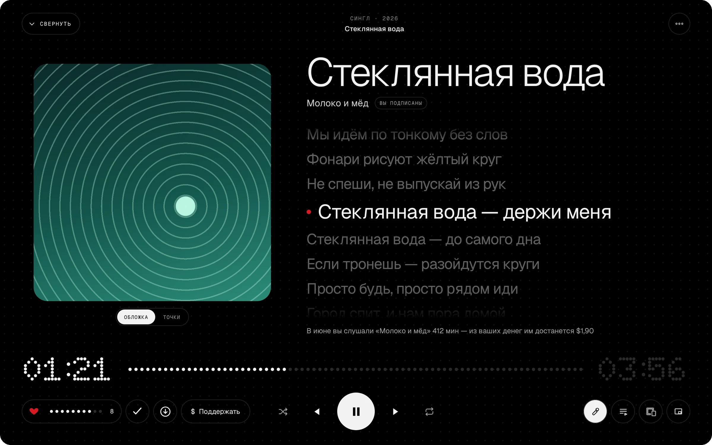

# Spotless

**Музыка — людям. Деньги — артистам.**

Spotless — открытый музыкальный сервис. По возможностям — как Spotify Premium, только вы сами решаете, сколько платить в месяц, и эти деньги получают артисты, которых вы действительно слушали. Комиссия сервиса 0%.

**[Открыть демо →](https://alastor1991.github.io/spotless-design/)** Работает в браузере на компьютере и на телефоне.





> Это дизайн-прототип: интерфейс настоящий и кликабельный, а музыка, артисты и деньги — имитация. Сервиса пока нет.

---

## Как это работает

1. **Вы выбираете сумму в месяц** — $2, $5, $10 или любую свою. Она ни на что не влияет: все функции доступны всем и всегда.
2. **Деньги делятся между теми, кого вы слушали**, пропорционально времени прослушивания. Не между всеми артистами сервиса и не между теми, кого слушают другие.
3. **Комиссия сервиса 0%.** Сетевые издержки — доли цента, и их видно до подтверждения.
4. **Можно отдельно поблагодарить** трек, альбом или артиста разовым донатом — маленькой кнопкой `$`.
5. **Всё прозрачно**: на странице артиста видно, сколько он в среднем получает с одного слушателя, а в разделе «Артистам» — кому ушли ваши деньги, вплоть до цента.



## Чем Spotless отличается

- **Не нужно ничего знать про технологии.** Под капотом — p2p-сеть и блокчейн, но в интерфейсе нет ни одного «страшного» слова. Вход через Google, ничего записывать не нужно. Для тех, кто хочет заглянуть под капот, в настройках есть раздел «Продвинутое».
- **Открытый код** под AGPL — не из идеологии, а потому что так честнее и удобнее слушателю.
- **Проект не стоит между вами и артистом**: он не хранит ваши деньги и ключи и не берёт процент.
- **Ничего из привычного не теряется**: медиатека, плейлисты (в том числе совместные), очередь, текст песни, загрузки для офлайна, умное перемешивание, друзья и совместное прослушивание, качество до FLAC 24/96.
- **Оценки от 1 до 10.** Тап по сердечку — «нравится», удержание — точная оценка. Оценки делают рекомендации точнее.

## Дизайн

Свой визуальный язык, а не копия Spotify и не стандартный Material Design.

- **Компьютер и Android — «Точка»**, в духе Nothing OS: чёрный фон, белые главные кнопки, точечные цифры и шкалы, один красный цвет — только там, где он что-то значит.
- **iPhone** — отдельный вариант в духе Liquid Glass, сдержанный, как в Telegram для iOS. Пока в макетах.
- **Настройки внешнего вида**: цветовые темы (в том числе светлые), акцентный цвет, обои, плотность интерфейса, форма плеера (плавающая капсула или панель во всю ширину), обмен темами.

| Альбом | Полноэкранный плеер |
|---|---|
|  |  |

## Что уже можно потрогать

В [демо](https://alastor1991.github.io/spotless-design/) работает почти всё, что вы ждёте от музыкального приложения: главная, поиск, медиатека, страницы альбомов, артистов и плейлистов, профили и совместное прослушивание, плеер с очередью и текстом песни, оценки, загрузки, донаты, пополнение баланса, настройки, английский язык. На телефоне — своя раскладка с нижней навигацией, мини-плеером и жестами (свайпы, долгое нажатие, смахивание вниз).

Всё, что вы меняете в демо, сохраняется в вашем браузере.

## Статус и планы

- **Сейчас**: дизайн-прототип для компьютера и Android доводится до готовности.
- **Дальше**: вариант для iPhone, планшет, экспорт дизайна в формат для настоящего приложения.
- **Потом**: кабинет артиста, подкасты, галерея тем от сообщества.

## Как будет устроено

Для тех, кому интересно:

- **Приложение** — нативное, на Rust и Slint, без веб-обёрток.
- **Музыка** раздаётся по p2p-сети (libp2p); на серверах проекта она не хранится. Серверная часть на Go — только для связности сети, поиска по каталогу и кабинета артиста.
- **Деньги** — в долларовом стейблкоине USDC в сети Solana, поэтому комиссии — доли цента, а курс не скачет. Пополнить можно картой, Apple Pay или Google Pay через лицензированного платёжного партнёра или переводом с другого кошелька.
- **Кошелёк некастодиальный**: ключи хранятся у пользователя (при входе через Google — в его Google-аккаунте), проект к ним доступа не имеет.

## Обратная связь

Нашли ошибку или вспомнили функцию Spotify, которой здесь не хватает? Напишите на **alastor1381@gmail.com** или **[в нашу группу Telegram для багов и предложений](https://t.me/+WPRopX-Wlz81ZWIy)**, лучше со скриншотом. Спасибо!

## Для разработчиков

Прототип работает без сборки: React и Babel загружаются в браузере.

```sh
python3 -m http.server 8765
# открыть http://localhost:8765/spotless/
```

Подробный бриф — устройство кода, дизайн-токены, правила текстов, порядок проверки и известные грабли — в [CLAUDE.md](CLAUDE.md). Он написан для ИИ-ассистента, который делает дизайн и фронтенд, но пригодится и людям.

ИИ-ассистенты в этом репозитории пишут только фронтенд. Бэкенд я буду писать сам, своими руками; для ассистентов это закреплено в [CLAUDE.md](CLAUDE.md) и [AGENTS.md](AGENTS.md).

## Лицензия

Код — под [GNU Affero General Public License v3.0](LICENSE). Артисты, названия и тексты песен в прототипе выдуманы, ничего лицензированного.

© 2026 Alastor1991
